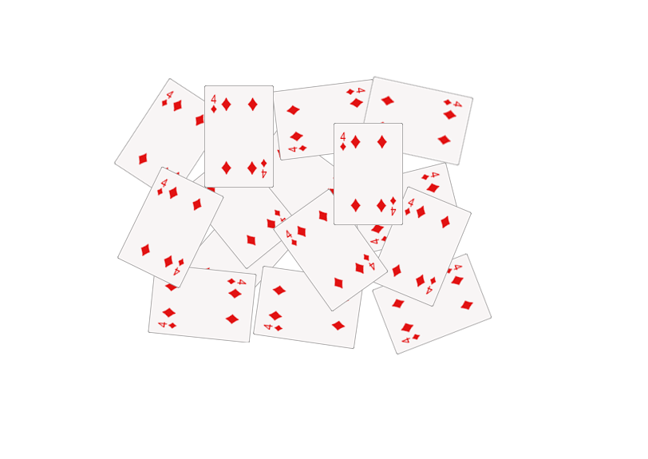

# Watershed — segmentação de imagens

Aplicação didática em **C# com Windows Forms e .NET 10** para demonstrar a segmentação de imagens pelo algoritmo Watershed. O projeto combina pré-processamento, Transformada de Distância (DT), geração de marcadores e inundação controlada para separar objetos encostados.

A imagem principal utilizada no desenvolvimento e na explicação do código é **[`cartas.png`](imgsExemplos/cartas.png)**. A imagem **[`coins.png`](imgsExemplos/coins.png)** é um exemplo complementar e exige ajustes na tela de passos, descritos abaixo.



## Download e execução

O programa pode ser baixado em **`.zip`**, com a senha **`123`** para extração. Extraia todo o conteúdo antes de executar o aplicativo.

> No estado atual deste repositório, o pacote compactado incluído é [`publicacao.rar`](publicacao.rar). Os arquivos do programa também estão disponíveis na pasta [`publicacao/`](publicacao/).

1. Utilize um computador com **Windows de 64 bits**.
2. Extraia o pacote do programa, informando a senha `123` quando solicitada.
3. Abra **`watershedAPP.exe`** na pasta extraída, mantendo os demais arquivos junto do executável.

A versão da pasta `publicacao/` inclui o runtime necessário para executar o aplicativo, sem precisar instalar o SDK do .NET.

## Como usar

### Exemplo principal: cartas

1. Abra o programa e acesse **Arquivo → Abrir**.
2. Selecione [`imgsExemplos/cartas.png`](imgsExemplos/cartas.png).
3. Acesse **Watershed → Rodar** para visualizar a segmentação completa.
4. Para salvar o resultado em PNG, utilize **Arquivo → Salvar**.

Para acompanhar as etapas, abra **Passo a Passo** e carregue a imagem novamente em **Arquivo → Abrir**, dentro da janela **Passos**. Use **Proximo** e **Anterior** para navegar pelos resultados intermediários.

### Exemplo complementar: moedas

Para utilizar [`imgsExemplos/coins.png`](imgsExemplos/coins.png), faça os ajustes na janela **Passos**:

1. Abra **Passo a Passo**.
2. Em **Arquivo → Abrir**, selecione `coins.png`.
3. Marque a opção **Denoiser antes do DT**, para aplicar o tratamento antes da Transformada de Distância.
4. Aumente o **threshold de `0,4` para `0,5`** no campo identificado como **Treshold** na interface.
5. Clique em **Recalcular** para aplicar os ajustes.
6. Navegue pelas etapas com **Proximo** e **Anterior**.

Esses ajustes são necessários para o exemplo complementar das moedas. O comando **Watershed → Rodar** da janela principal utiliza o fluxo padrão com threshold `0,4`; para configurar o denoiser e o threshold, utilize a janela **Passos**.

## Etapas do processamento

O fluxo demonstrado pelo programa inclui:

1. Imagem original e adequação do fundo, com criação da máscara de fundo.
2. Realce com Laplaciano e sharpen.
3. Conversão para escala de cinza e binarização.
4. Tratamento anterior à DT, quando a opção **Denoiser antes do DT** está marcada.
5. Transformada de Distância, destacando as regiões internas dos objetos.
6. Aplicação do threshold para obter os marcadores.
7. Ajuste morfológico e rotulação dos marcadores.
8. Inundação controlada por uma fila ordenada e exibição das regiões segmentadas.

As cores dos objetos são geradas aleatoriamente, podendo variar entre execuções.

## Material didático

A explicação completa está em **[Material_Didatico_Watershed_Versao_Final.docx](Material_Didatico_Watershed_Versao_Final.docx)**. O documento apresenta os conceitos do Watershed, as etapas ilustradas com as cartas, os cálculos da Transformada de Distância com matrizes, a geração de marcadores, a inundação e exemplos de aplicações, além das referências bibliográficas.

A pasta [`imgsExemplos/`](imgsExemplos/) reúne as imagens de entrada e os resultados intermediários dos exemplos.

## Executar pelo código-fonte

Em um ambiente Windows com o **SDK do .NET 10** instalado, execute na raiz do repositório:

```powershell
dotnet run --project watershedAPP/watershedAPP.csproj
```

O código da interface está em [`watershedAPP/`](watershedAPP/), e as implementações de pré-processamento, filtros morfológicos, Transformada de Distância, marcadores e Watershed estão em [`watershedAPP/classes/`](watershedAPP/classes/).
